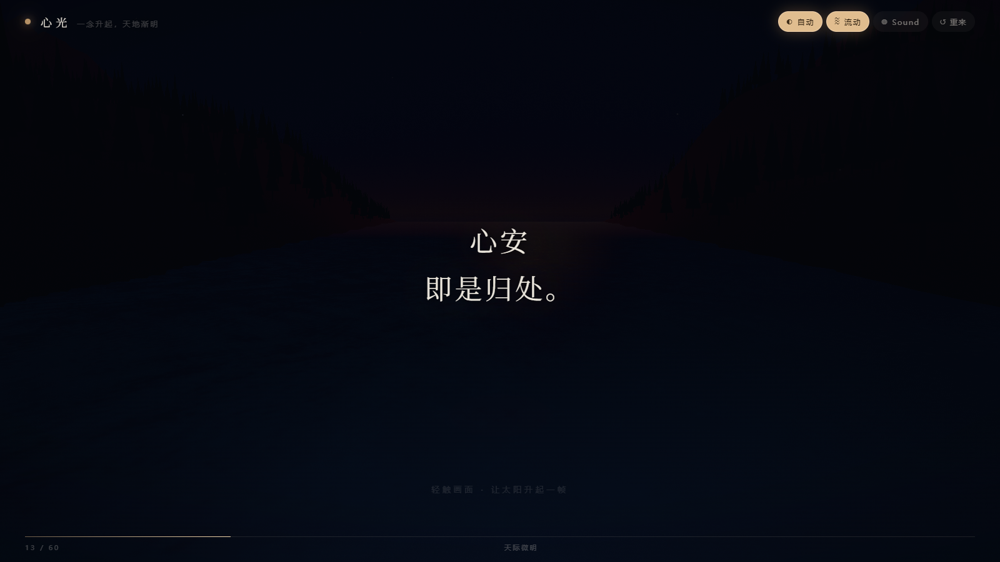
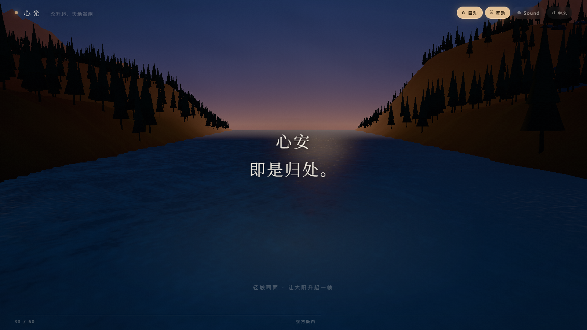
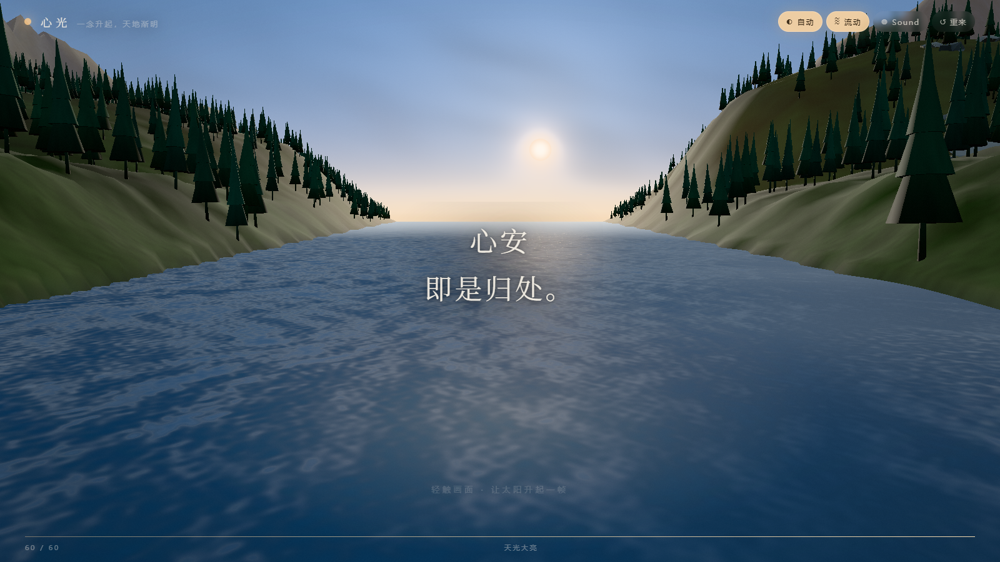
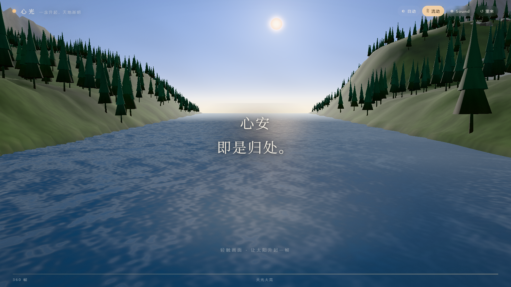

# 心光 · 一念升起，天地渐明

一个用 three.js / WebGL 写的正念小站：屏幕上随机浮现一句正念语录，背景是森林、海湾与远山。
打开时先是一屏几乎全黑的打字机独白，静下来之后轻触画面——**每轻触一次，太阳就升起一帧，天色随之亮一分**，
六十帧之后天光大亮，你才看清眼前有什么。而太阳不会停在顶点，它会一直、慢慢地往上走。

线上地址：**<https://xinguang.surge.sh/>**（短域名，surge.sh 免费二级域）
镜像：<https://joken007.github.io/xinguang/>（GitHub Pages 正本）

## 预览

| 首屏 | 黎明之前 → 天际微明 | 东方既白 | 天光大亮 | 天亮之后 |
| --- | --- | --- | --- | --- |
|  |  |  |  |  |

## 运行

零依赖、无需构建，用任意静态服务器打开即可（ES module 不能用 `file://` 直接打开）：

```bash
node serve.mjs          # → http://127.0.0.1:5173
# 或者
python -m http.server 5173
```

### 想直接双击打开？

另存了一个**单文件版**：`心光.html`（约 1.5 MB，three.js 与全部代码都内联在同一个文件里）。
双击它、或拖进浏览器即可运行，不依赖任何服务器、不联网。

```bash
node tools/build-single.mjs   # 源码改动后重新打包，产出 E:\心光\心光.html
```

three.js（r169）已放在 `vendor/three.module.js`，不需要 npm install。

## 操作

| 操作 | 效果 |
| --- | --- |
| 首屏任意轻触 / 按键 | 补全打字（第一次）、淡出进入画面（第二次）；进入的那一下不会升帧 |
| 轻触 / 点击画面 | 太阳升起一帧；满六十帧之后继续一帧一帧往上，没有上限 |
| `空格` / `→` / `回车` | 同上（长按不连发，保持"一帧一帧"的节奏） |
| `A` 自动 | 自动逐帧升日（首屏期间暂停；推进到 90 帧就自动停手，把画面交还给你） |
| `M` 流动 | 开关水波与光影的持续流动 |
| `S` 声音 | 开关音乐（实时合成的四小节循环 + 环境床，无任何音频文件） |
| `R` 重来 | 回到黎明之前，换一条语录 |

自动模式有上限（90 帧）：它帮你把画面点亮、让你看清这个世界，但**最后一程要你自己点**——
到 90 帧它会把「自动」按钮熄掉；此后你随手点一下任何地方，自动模式就重新可用。

语录共 **436 条**，抽取顺序做了**跨会话去重**（记录在 localStorage）：关掉页面、隔天再来，也不会看到重复的句子；
把 436 条全部看过一遍之后，记录自动清零、重新洗牌，新一轮的第一条还会专门避开上一轮的末条。
太阳升到不同高度时，页脚的相位文字会跟着变
（黎明之前 / 天际微明 / 东方既白 / 晨光初照 / 旭日东升 / 天光大亮）。

## 发布到 GitHub / 变成网站

仓库已经可以直接当 GitHub Pages 站点托管（全部资源走相对路径、带 `.nojekyll`、零构建）。
发布流程写成了一条命令，另见 [`GITHUB.md`](GITHUB.md) 的逐步说明：

| 命令 | 作用 |
| --- | --- |
| `npm run preflight` | 只读体检：告诉你发布前还缺什么（令牌、仓库、Pages、DNS、工作区状态），什么都不改 |
| `npm run live` | 一条命令走完：体检 → 发布（建仓库/推送/开 Pages/验线上）→ 把元数据指向线上地址；体检不通过**不会**部署 |
| `npm run auth` | 设备码登录：码会自动续期，授权后把令牌写到仓库外的临时目录 |
| `npm run release` | 建仓库 → 推送 → 开启 Pages → 轮询构建 → **真打开线上地址验一遍** |
| `npm run polish -- --url <线上地址> [--push]` | 把元数据和文档里的占位地址改成真实地址、重打包单文件版、提交（并可推送） |
| `npm run domain -- --email you@example.com` | 向 `is-a-dev/register` 提 PR 申请 `xinguang.is-a.dev`（邮箱是必填的公开联系方式） |
| `npm run custom-domain -- --domain xinguang.is-a.dev` | PR 合并后把自定义域填进 Pages、等它生效、开强制 HTTPS、再验线上 |
| `npm run verify -- <url>` | 独立校验任意已部署地址（首页 200 + 标记齐全 + 依赖全 200） |

## 目录

```
心光.html               单文件版（three.js + 全部代码内联，双击即开）
preview/                首页展示用的五张图（首屏 / 黎明 / 既白 / 大亮 / 天亮之后）
screenshots/            六个相位各一张实拍（1280×720，由无头浏览器出图）
index.html              页面骨架（画布 + 语录 + 页脚进度）
serve.mjs               零依赖本地静态服务器
site.webmanifest        可当应用安装（图标、主题色、独立窗口）
robots.txt              允许爬虫收录
icon-192/512.png        应用图标（与内联 SVG favicon 同一个标记）
apple-touch-icon.png
tools/build-single.mjs  把上面的多文件版打包成 心光.html
vendor/three.module.js  three.js r169
src/
  main.js               场景装配、逐帧升日状态机、输入与渲染循环
  config.js             镜头、太阳轨迹（两段 + 软上限）、白天曲线、帧数与各阶段数值曲线
  quotes.js             语录库（436 条）、相位表、跨会话去重抽取器（localStorage）
  styles.css            排版与氛围层（暗场窗帘 / 暖洗 / 暗角）
  ui/intro.js           首屏：黑底 + 打字机独白，关掉之前吞掉全部输入
  ui/hud.js             DOM 层：语录切换、进度、相位、氛围、无障碍播报
  audio/music.js        音乐：WebAudio 实时合成的 Cmaj7–Am7–Fmaj7–G6 循环
  world/sky.js          天空穹顶（渐变 + 太阳方位暖带 + 日核与日晕）
  world/sea.js          海面（菲涅尔、波峰碎光、太阳光路、雾）
  world/terrain.js      地形（极坐标分带网格 + 山丘 + 远山 + 3200 棵针叶树 + 岩块）
  post/composite.js     自写 HDR 后期：亮部提取 → 高斯 → 色调映射 → 暗角/颗粒 → sRGB
  util/noise.js         值噪声 / fBm / 可复现随机
  util/resources.js     共享材质与纹理
```

## 几个实现要点

- **不引入后期处理库**：`src/post/composite.js` 自己搭了一条 HDR 链路
  （HalfFloat 目标 → 1/4 分辨率亮部提取 → 横纵两趟 9 tap 高斯 → Khronos PBR Neutral 色调映射 → 手动 sRGB 编码）。
  曝光、泛光、暗角都随升日进度联动，所以"变亮"不只是加一层白幕。
- **一帧一帧，而且没有终点**：进度是整数帧，太阳高度、天空色、海面色、雾、光照强度都用同一条曲线求值；
  渲染层再对取值做平滑追赶，所以点得快时太阳会"追"上来，但读数永远是你点到的帧。
  太阳高度分两段：前 60 帧从 -8.9° 升到 5.7°（越接近顶点越慢），之后用一条指数尾巴
  `MAX - (MAX-END)*exp(-(p-1)/2)` 继续往上，再过一道**平滑软上限**——这样它单调、有界、处处连续：
  有界单调函数必有极限，所以"永远在升"数学上只能取极限，代码让这个极限落在
  `CEIL - BAND*ln2 ≈ 14.6°`，距画面上缘（+17.6°）还留 2.96°，太阳圆盘（角半径约 0.97°）与整圈日晕都不会被切掉。
- **天亮之后，世界还在动（不会在第 60 帧冻住）**：第二阶段的进度由 `dayAmountAt(p)` 给出
  （`1 - exp(-(p-1)/2.5)`），它单独驱动天色、云、星空、水面、地形自发光、雾浓度、后期曝光与泛光。
  于是点过 60 帧之后，天顶会继续往正午的深蓝走、云会褪尽、水面更透更冷、雾继续变薄、曝光再抬一点——
  这些变化在截图上是可测量的：v=1 → v=6（360 帧）时天空平均色从 (99,119,139) 走到 (116,137,160)、
  全图平均亮度从 88 升到 100 上下，而不是"只有太阳在滑"。
- **地形的分带极坐标网格**：0~30m 环距 1.2m、30~110m 2.4m、110~210m 4.5m、210~600m 10m，
  远处再补低密度带——镜头附近顶点密、地平线附近省，23.9 万三角形 / 3 个 draw call。
- **颜色一致性**：自定义着色器自己写颜色空间编码，与 three 的标准材质对齐；验收一律看最终后期输出，
  不看中间缓冲（中间缓冲少一次 sRGB 编码，会亮 2.4 倍，容易误判）。
- **太阳与水面反光对齐**：光路中线不再用"镜面横向偏移比"（那个写法会让亮带永远贴在画面正中），
  而是把水面点相对相机的**方位角**与太阳方位角相减得到残差（弧度制），
  于是任意距离上 e=0 的中线都精确落在太阳的屏幕横坐标上；宽度也按弧度重标定（近 0.07 rad → 远 0.13 rad）。
- **日晕不会被画面上缘切掉**：日晕半径不是固定倍数，而是每帧取
  `min(自然角半径, 太阳中心到画面上缘的角余量 × 0.92)`；
  太阳爬到软上限附近时晕会自然收成围着太阳的一圈紧光（同时补一点亮度），而不是被削平成一条硬边。
- **音乐是实时合成的**，没有任何音频文件：60 BPM、4/4，四小节循环 Cmaj7 → Am7 → Fmaj7 → G6
  （每两轮换一套进行，共四套轮转，两分多钟才回到最初），分 pad / bass / 旋律 / 高音铃 / 环境床五层；
  混响用程序生成的 3 秒指数衰减 IR，母带过一道 lowpass + 软压缩。
  音频图在首次轻触时才创建（浏览器自动播放策略），音量与低通截止都随升日进度慢慢变亮，
  离开页面时淡出，避免混响被硬切断。
- **首屏是第一人称的独白**：几乎是全黑的底，逐字打字，标点处停顿更久；
  打字中轻触 = 补全，再轻触 = 淡出（900ms）后才真正开始。它的监听注册在 window 捕获阶段，
  所以首屏期间点画面不会"提前"升帧，进入的那一下也不会。
- **可复现**：所有噪声都走固定 seed，同一台机器每次打开都是同一个世界，方便截图比对。
- **无障碍**：画面是 `role="button"` 可聚焦元素，相位变化通过 `aria-live` 播报；`prefers-reduced-motion`
  下会自动关掉持续流动。

## 部署

仓库已经可直接用 GitHub Pages 托管（资源全相对路径、带 `.nojekyll`）。
推送与免费域名的分步说明见 [GITHUB.md](GITHUB.md)，域名方案调研见 [docs/free-domain.md](docs/free-domain.md)。

## 已知取舍

- 风格是**低多边形写意**而不是写实渲染：海岸两侧的山体是平滑的草坡 + 剪影针叶林，
  近距离能看出面片感；远处的岩面与林窗主要靠顶点色交代。
- 全亮那一帧的口岸草地上仍偏黄绿、树是背光剪影，是刻意保留的"清晨逆光"关系；
  想要更写实的岩壁与林木，需要换成法线贴图 + 更密的网格。
- 首屏独白不提供"跳过"按钮：按设计它只有两句话的时间，任意轻触就能过；
  需要程序化跳过时可以调 `window.__XG_INTRO__.close()`。
- 需要支持 WebGL2 的浏览器；创建失败时页面会给出提示而不是黑屏。
